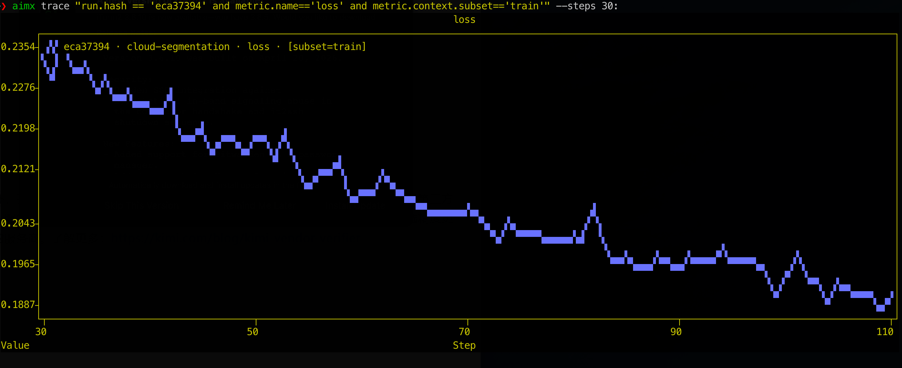
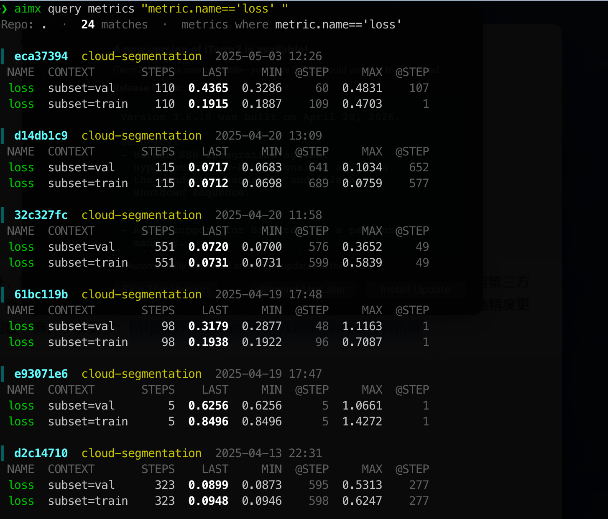
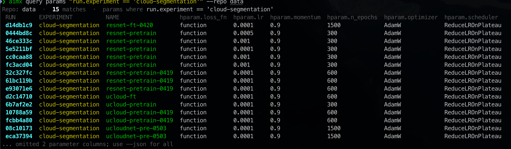
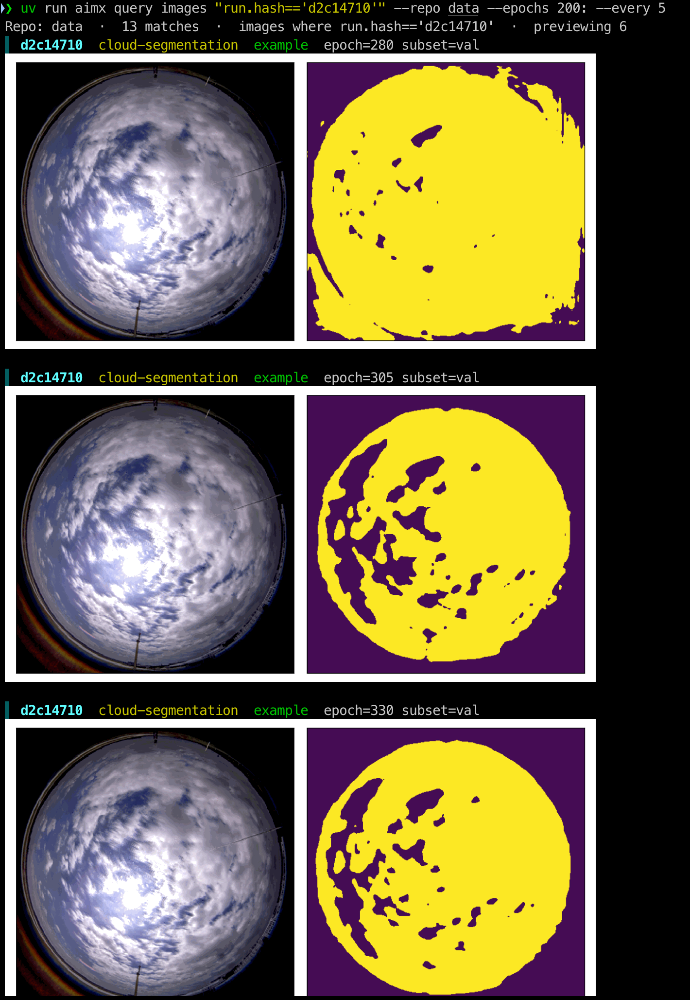
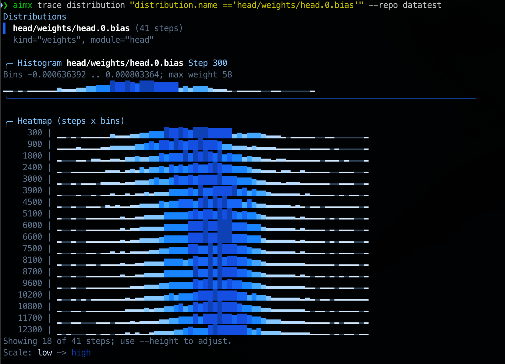
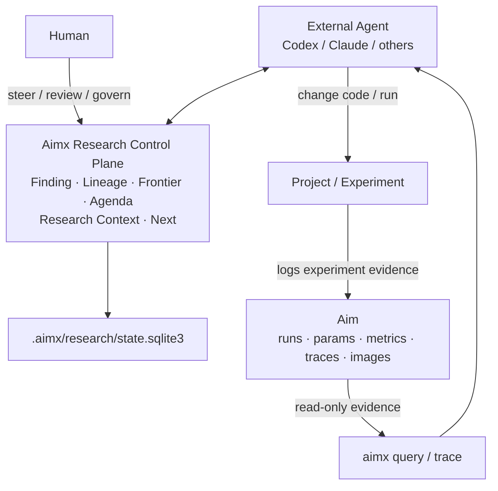

# aimx

**English | [简体中文](./README.zh-CN.md)**



[](./LICENSE)
[](./pyproject.toml)
[](https://pypi.org/project/aimx/)
[](https://github.com/blizhan/aimx/actions/workflows/CI.yaml)
[](https://github.com/blizhan/aimx/actions/workflows/publish.yaml)

`aimx` is a safe, CLI-first companion for native [Aim](https://github.com/aimhubio/aim), built for both terminal users and AI research agents.

It is organized around three layers:

1. **Read-only Observation (`query` & `trace`)**: Inspect run metrics, hyperparameters, time-series curves, distributions, and inline terminal images in human- or machine-readable formats (`--json`, `--csv`, `--plain`).
2. **Research Control Plane (`research`, `finding`, `lineage`, `frontier`)**: Persist what was learned and what to run next in a sidecar database (`.aimx/research/state.sqlite3`) while keeping `.aim` strictly read-only.
3. **Agent Skills (`skills/`)**: Ready-to-use workflows for evidence collection, bounded multi-agent research loops, and evidence-grounded retrospectives.

Commands not owned by `aimx` are transparently delegated to the native `aim` CLI.

---

## Quick Start

### 1. Install CLI

```bash
uv add aimx
# or: pip install aimx
```

Verify your environment and native Aim passthrough:

```bash
aimx --help
aimx version
aimx doctor
```

### 2. Query an Aim Repository

If your working directory is an Aim repo root, `--repo` can be omitted. Otherwise pass the repo root (`data`) or `.aim` directory (`data/.aim`):

```bash
aimx query metrics --repo data      # Summarize metrics across runs
aimx query params --repo data       # Compare hyperparameters and durations
aimx query images --repo data       # Preview logged images inline in the terminal
aimx trace --repo data              # Plot metric curves in the terminal
```

### 3. Install Agent Skills (Optional)

```bash
npx skills install blizhan/aimx
```

| Skill | Purpose |
| --- | --- |
| `$aimx` | Read-only experiment observation and Research State updates. |
| `$aimx-autoresearch` | Bounded multi-agent research loops with per-agent model/effort configs and checkpoint resume. |
| `$aimx-retro` | Evidence-based research retrospectives (`retro.json` & `RETRO.md`). |
| `$aimx-hydra-lightning-builder` | Scaffold or audit Hydra + PyTorch Lightning + Aim projects. |

---

## Command Overview

| Command | Purpose |
| --- | --- |
| `aimx` / `aimx help` / `aimx version` | Show CLI help or version info. |
| `aimx doctor` | Verify native `aim` availability for passthrough. |
| `aimx query metrics [AIMQL]` | Summarize matching metric series (`last`, `min`, `max`, step count). |
| `aimx query params [AIMQL]` | Compare run-level parameters and run durations. |
| `aimx query images [AIMQL]` | List and inline-preview matching image artifacts. |
| `aimx trace [AIMQL]` | Plot, tabulate, or export metric time series. |
| `aimx trace distribution [AIMQL]` | Visualize or export tracked distribution histograms and heatmaps. |
| `aimx research` | Read/update durable research state, bounded context, agenda, and next work. |
| `aimx finding` / `lineage` / `frontier` | Inspect and govern findings, relationships, and research directions. |
| `aimx <native-command>` | Passed through directly to native `aim` (e.g. `aimx up`, `aimx runs ls`). |

---

## Observation CLI (`query` & `trace`)

All `query` and `trace` commands accept an optional [AimQL](https://aimstack.readthedocs.io/en/latest/using/search.html) filter expression (defaults to `run.hash != ''`). Short run hashes (e.g. `run.hash == 'eca37394'`) are expanded automatically.

### Common Filtering & Output Flags

- **Output format**: Rich terminal view by default; `--json`, `--csv` (`trace`), `--table` (`trace`), or `--oneline` / `--plain` for scripts and agents.
- **Range & density**: `--steps START:END`, `--epochs START:END`, `--head N`, `--tail N`, `--every K`.

### Metrics (`aimx query metrics`)

Groups matching metric series by run and reports summary statistics.



```bash
aimx query metrics "metric.name == 'loss'" --repo data
aimx query metrics "metric.name == 'loss' and run.hparams.lr > 0.001" --repo data --json
aimx query metrics "metric.name == 'loss'" --repo data --steps 100:500 --every 5 --oneline
```

### Run Parameters (`aimx query params`)

Compares run-level parameters and durations across runs. Missing requested keys render as `-` in tables and under `missing_params` in JSON.



```bash
aimx query params --repo data
aimx query params "run.experiment == 'cloud-segmentation'" --repo data \
  --param hparam.lr --param hparam.optimizer --json
```

### Images (`aimx query images`)

Renders matched images inline on [supported graphics terminals](https://github.com/lnqs/textual-image/tree/main#support-matrix-1) (iTerm2, Kitty, WezTerm, Konsole, Ghostty, VS Code, etc.) and falls back to ANSI character art elsewhere.



```bash
aimx query images --repo data
aimx query images "images" --repo data --epochs 10:50 --max-images 10
aimx query images --repo data --json   # Metadata only, disables inline rendering
```

### Metric Curves (`aimx trace`)

Overlays matching metric sequences on a terminal plot, or exports full series.

```bash
aimx trace "metric.name == 'loss'" --repo data
aimx trace "metric.name == 'loss'" --repo data --table
aimx trace "metric.name == 'loss'" --repo data --csv > loss.csv
aimx trace "metric.name == 'loss'" --repo data --tail 50 --json
```

### Distributions (`aimx trace distribution`)

Renders a current-step histogram and step-by-bin heatmap for tracked distribution sequences, or exports raw histogram tensors.



```bash
aimx trace distribution --repo data
aimx trace distribution "distribution.name == 'weights'" --repo data --step 12300
aimx trace distribution "distribution.name == 'weights'" --repo data --json
```

---

## AutoResearch Control Plane

Aimx separates experiment logging, durable research memory, and agent execution:

> **Aim stores what happened. Aimx stores what we learned and what to do next. External agents decide and execute.**



### Core Concepts

| Concept | Role |
| --- | --- |
| **Finding** | Durable, immutable research claim backed by Aim run or file evidence. |
| **Lineage** | Typed links between Findings (`supports`, `challenges`, `refines`, `supersedes`). |
| **Frontier** | Human/agent-steerable research directions, priorities, and statuses. |
| **Agenda** | Persisted Experiment Contracts for proposed next experiments. |
| **Research Context** | Deterministic, objective-specific shared memory compiled within a strict UTF-8 byte budget. |
| **ResearchUpdate** | Atomic, optimistic-concurrency transaction updating Findings, Lineage, Frontier, and Agenda. |

### Single-Round Workflow & Cross-Agent Handoff

Because state lives in `<repo>/.aimx/research/state.sqlite3`, any new agent session can resume without prior chat transcripts:

```bash
# 1. Inspect state, compile bounded context (bytes), and pick next Agenda contract
aimx research state --repo data --json
aimx research context --repo data --objective "improve low-data accuracy" --budget 12000 --json
aimx research next --repo data --json

# 2. Agent modifies code, runs experiment, and inspects read-only Aim evidence
aimx query metrics "metric.name == 'accuracy'" --repo data --json

# 3. Validate and commit atomic ResearchUpdate (exits 3 on revision conflict)
aimx research update --repo data --file update.json --dry-run --json
aimx research update --repo data --file update.json --json
```

See the [AutoResearch protocol reference](skills/aimx/references/autoresearch-protocol.md) for payload schemas and revision-conflict rules.

### Bounded Multi-Agent Loops (`$aimx-autoresearch`)

`$aimx-autoresearch` orchestrates multi-round, multi-subagent research against a declarative JSON config ([example](skills/aimx-autoresearch/assets/config.example.json)):

- **Lead-only writes**: Subagents run isolated tasks in separate worktrees and return structured evidence; **only the lead agent** integrates code and submits `ResearchUpdate`.
- **Explicit model & budget control**: Configure `max_rounds`, success criteria, and per-agent `model` / `reasoning_effort`.
- **Traceable Aim runs**: Loop runs record `run.experiment = "ar-{loop_id}"`, `run["aimx"]` metadata (`loop_id`, `round`, `role`, `hypothesis`), and `loop:` / `round:` tags.
- **Explicit checkpoint resume**: State is tracked in `<repo>/.aimx/autoresearch/<loop-id>/`.

```bash
# Validate config, initialize loop checkpoint, or inspect status
uv run python skills/aimx-autoresearch/scripts/control.py validate --config autoresearch.json
uv run python skills/aimx-autoresearch/scripts/control.py init --config autoresearch.json --loop-id accuracy-study
uv run python skills/aimx-autoresearch/scripts/control.py status \
  --loop-dir data/.aimx/autoresearch/accuracy-study --config autoresearch.json
```

See the [loop contract](skills/aimx-autoresearch/references/loop-contract.md) for full dispatch, integration, and resume rules.

### Evidence-Based Retrospectives (`$aimx-retro`)

`$aimx-retro` audits completed experiments (standalone or between autoresearch rounds) without modifying `.aim` or loop state. It separates execution failures from hypothesis failures, tags every claim's evidence basis (`observed`, `reported`, `inferred`, `unknown`), and publishes to `<repo>/.aimx/retro/<report-id>/`:

```bash
uv run python skills/aimx-retro/scripts/report.py validate --file draft.json
uv run python skills/aimx-retro/scripts/report.py publish --file draft.json
```

See the [retro report format](skills/aimx-retro/references/report-format.md) and [evidence guide](skills/aimx-retro/references/evidence-guide.md).

---

## Safety & Runtime Contract

- **Non-invasive**: `aimx` never replaces the `aim` binary or modifies installed `aim` packages.
- **Read-only `.aim`**: All `query`, `trace`, `doctor`, `research`, and `retro` commands treat `.aim` as strictly read-only.
- **Isolated sidecars**: Explicit writes only touch `<repo>/.aimx/` (`research/`, `autoresearch/`, `retro/`), which can be backed up or deleted without affecting Aim runs.

## Documentation & Development

- [CONSTITUTION.md](./CONSTITUTION.md) — Project scope and safety invariants.
- [specs/](./specs) — Feature specifications, contracts, and quickstarts.
- [AimQL basics](https://aimstack.readthedocs.io/en/latest/using/search.html) — Filter expression syntax.

Local development targets **Python 3.12** (runtime supports `>=3.10,<3.13`):

```bash
uv python install 3.12
uv venv --python 3.12
uv sync --group dev
uv run pytest
```
