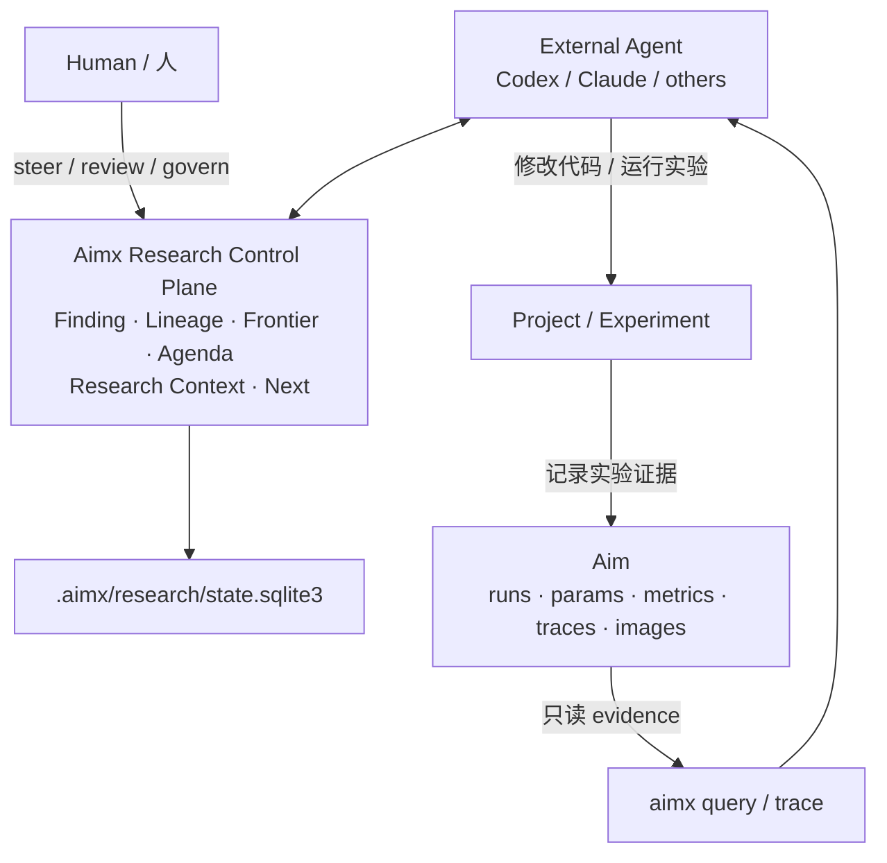

# aimx

**[English](./README.md) | 简体中文**


[](./LICENSE)
[](./pyproject.toml)
[](https://pypi.org/project/aimx/)
[](https://github.com/blizhan/aimx/actions/workflows/CI.yaml)
[](https://github.com/blizhan/aimx/actions/workflows/publish.yaml)

`aimx` 是原生 [Aim](https://github.com/aimhubio/aim) 的安全、CLI-first 伴生工具，同时面向终端用户与 AI 研究 Agent。

核心能力分为三层：

1. **只读实验观测 (`query` & `trace`)**：在终端或通过脚本（`--json`、`--csv`、`--plain`）查询指标汇总、超参数对比、时间序列曲线、分布热力图与终端内嵌图片预览。
2. **研究状态控制面 (`research`、`finding`、`lineage`、`frontier`)**：在不修改 `.aim` 数据的前提下，将研究结论、结论谱系、探索前沿与下一步实验契约持久化到 `.aimx/research/state.sqlite3`。
3. **Agent Skills (`skills/`)**：开箱即用的实验证据采集、按轮数预算运行的多 Agent 研究循环，以及基于证据的结构化研究复盘。

`aimx` 未显式接管的命令会原样透传给环境中的原生 `aim` CLI。

---

## 快速开始

### 1. 安装 CLI

```bash
uv add aimx
# 或：pip install aimx
```

检查环境与原生 Aim 透传状态：

```bash
aimx --help
aimx version
aimx doctor
```

### 2. 查询 Aim 仓库

当前目录即为 Aim 仓库根目录时可省略 `--repo`；否则可传入仓库根目录（`data`）或 `.aim` 目录（`data/.aim`）：

```bash
aimx query metrics --repo data      # 汇总所有 run 的指标统计
aimx query params --repo data       # 比较超参数与运行时长
aimx query images --repo data       # 在支持图形协议的终端内预览图片
aimx trace --repo data              # 在终端绘制指标曲线
```

### 3. 安装 Agent Skills（可选）

```bash
npx skills install blizhan/aimx
```

| Skill | 用途 |
| --- | --- |
| `$aimx` | 只读采集实验证据并更新 Research State。 |
| `$aimx-autoresearch` | 按轮数预算运行多 Subagent 研究循环，支持逐 Agent 指定 model / effort 与检查点续跑。 |
| `$aimx-retro` | 基于证据的结构化研究复盘（生成规范 `retro.json` 与 `RETRO.md`）。 |
| `$aimx-hydra-lightning-builder` | Hydra + PyTorch Lightning + Aim 项目脚手架与迁移审计。 |

---

## 命令总览

| 命令 | 用途 |
| --- | --- |
| `aimx` / `aimx help` / `aimx version` | 查看 CLI 帮助或版本信息。 |
| `aimx doctor` | 检查原生 `aim` 是否可用于命令透传。 |
| `aimx query metrics [AIMQL]` | 按 run 汇总匹配指标（`last`、`min`、`max`、步数）。 |
| `aimx query params [AIMQL]` | 对比跨 run 的超参数与运行时长。 |
| `aimx query images [AIMQL]` | 查询并内嵌预览匹配的图像记录。 |
| `aimx trace [AIMQL]` | 绘制、表格化或导出指标时间序列。 |
| `aimx trace distribution [AIMQL]` | 渲染或导出分布序列的直方图与 step-by-bin 热力图。 |
| `aimx research` | 读取/更新 Research State、编译有界上下文、查看 Agenda 与下一项实验。 |
| `aimx finding` / `lineage` / `frontier` | 查看、评估、评论与治理研究结论、谱系关系及探索方向。 |
| `aimx <原生命令>` | 直接委托给原生 `aim`（如 `aimx up`、`aimx runs ls`）。 |

---

## 实验观测 CLI (`query` & `trace`)

所有 `query` 与 `trace` 命令均接受可选的 [AimQL](https://aimstack.readthedocs.io/en/latest/using/search.html) 过滤表达式（省略时默认为 `run.hash != ''`），并支持短 run hash 自动展开（如 `run.hash == 'eca37394'`）。

### 通用输出与采样参数

- **输出模式**：默认渲染终端富表格/图表；脚本与 Agent 可使用 `--json`、`--csv`（`trace`）、`--table`（`trace`）或 `--oneline` / `--plain`。
- **范围与采样**：`--steps START:END`、`--epochs START:END`、`--head N`、`--tail N`、`--every K`。

### 指标汇总 (`aimx query metrics`)


```bash
aimx query metrics "metric.name == 'loss'" --repo data
aimx query metrics "metric.name == 'loss' and run.hparams.lr > 0.001" --repo data --json
aimx query metrics "metric.name == 'loss'" --repo data --steps 100:500 --every 5 --oneline
```

### 参数对比 (`aimx query params`)

自动发现或使用 `--param KEY` 指定对比列；缺失参数在终端显示为 `-`，在 JSON 中归入 `missing_params`，同时附带 run duration。


```bash
aimx query params --repo data
aimx query params "run.experiment == 'cloud-segmentation'" --repo data \
  --param hparam.lr --param hparam.optimizer --json
```

### 图像预览 (`aimx query images`)

在[支持图形协议的终端](https://github.com/lnqs/textual-image/tree/main#support-matrix-1)（iTerm2、Kitty、WezTerm、Konsole、Ghostty、VS Code 等）中直接渲染图片，普通终端自动降级为字符画。


```bash
aimx query images --repo data
aimx query images "images" --repo data --epochs 10:50 --max-images 10
aimx query images --repo data --json   # 仅输出元数据，不渲染图片
```

### 指标曲线 (`aimx trace`)

将多个匹配 run 的指标序列叠加绘制在同一张终端图表中，或导出完整序列。

```bash
aimx trace "metric.name == 'loss'" --repo data
aimx trace "metric.name == 'loss'" --repo data --table
aimx trace "metric.name == 'loss'" --repo data --csv > loss.csv
aimx trace "metric.name == 'loss'" --repo data --tail 50 --json
```

### 分布可视化 (`aimx trace distribution`)

在终端渲染当前 step 的分布直方图与全局 step-by-bin 热力图，或导出底层张量数据。


```bash
aimx trace distribution --repo data
aimx trace distribution "distribution.name == 'weights'" --repo data --step 12300
aimx trace distribution "distribution.name == 'weights'" --repo data --json
```

---

## AutoResearch 研究控制面

Aimx 将实验数据记录、研究认知沉淀与 Agent 执行明确解耦：

> **Aim 记录“发生了什么”；Aimx 记录“学到了什么、下一步做什么”；外部 Agent 负责推理与执行。**



### 核心概念

| 概念 | 职责 |
| --- | --- |
| **Finding** | 由实验或文件证据支撑的持久化研究结论（claim 不可变，认知演进通过新 Finding 表达）。 |
| **Lineage** | Finding 之间的有向关系（`supports`、`challenges`、`refines`、`supersedes`）。 |
| **Frontier** | 人与 Agent 共同维护的探索方向、优先级与状态。 |
| **Agenda** | 已持久化的下一步实验契约（Experiment Contract）。 |
| **Research Context** | 根据当前目标（objective）在严格 UTF-8 字节预算内确定性编译的共享上下文。 |
| **ResearchUpdate** | 带乐观锁版本号（revision）的原子更新事务，统一提交 Finding、Lineage、Frontier 与 Agenda 变更。 |

### 单轮工作流与跨 Session 接力

研究状态独立保存在 `<repo>/.aimx/research/state.sqlite3`，新的 Agent Session 无需历史聊天记录即可直接接力：

```bash
# 1. 读取当前状态、按字节预算编译上下文、获取下一项实验契约
aimx research state --repo data --json
aimx research context --repo data --objective "improve low-data accuracy" --budget 12000 --json
aimx research next --repo data --json

# 2. Agent 修改代码、运行实验，并通过只读查询观测结果
aimx query metrics "metric.name == 'accuracy'" --repo data --json

# 3. 校验并原子提交 ResearchUpdate（若出现 revision 冲突则返回退出码 3）
aimx research update --repo data --file update.json --dry-run --json
aimx research update --repo data --file update.json --json
```

完整的 JSON 契约与冲突处理机制见 [AutoResearch 协议规范](skills/aimx/references/autoresearch-protocol.md)。

### 多 Agent 预算循环 (`$aimx-autoresearch`)

`$aimx-autoresearch` 基于声明式配置（[配置示例](skills/aimx-autoresearch/assets/config.example.json)）组织多轮、多 Subagent 协作研究：

- **单一写入者原则**：Subagent 在隔离 worktree 中执行任务并返回结构化结果；**仅主 Agent (Lead)** 负责代码集成与提交 `ResearchUpdate`。
- **显式预算与模型配置**：支持设置 `max_rounds`、验收标准，以及逐 Agent / 逐轮指定 `model` 与 `reasoning_effort`。
- **标准化 Run 追踪**：自动约定 `run.experiment = "ar-{loop_id}"`、`run["aimx"]` 元数据（`loop_id`、`round`、`role`、`hypothesis`）以及 `loop:` / `round:` 标签。
- **可验证检查点续跑**：循环状态保存在 `<repo>/.aimx/autoresearch/<loop-id>/`，与 Research State 解耦。

```bash
# 校验配置、初始化循环检查点或查看循环状态
uv run python skills/aimx-autoresearch/scripts/control.py validate --config autoresearch.json
uv run python skills/aimx-autoresearch/scripts/control.py init --config autoresearch.json --loop-id accuracy-study
uv run python skills/aimx-autoresearch/scripts/control.py status \
  --loop-dir data/.aimx/autoresearch/accuracy-study --config autoresearch.json
```

详细派发、集成与续跑规则见 [Loop Contract](skills/aimx-autoresearch/references/loop-contract.md)。

### 基于证据的研究复盘 (`$aimx-retro`)

`$aimx-retro` 支持对历史实验进行独立复盘或轮次间复盘，全程对 `.aim` 与循环状态保持**只读**。它严格区分工程执行故障（OOM/崩溃）与科学假说证伪，强制标注每条结论的证据来源（`observed`、`reported`、`inferred`、`unknown`），并将报告发布到 `<repo>/.aimx/retro/<report-id>/`：

```bash
uv run python skills/aimx-retro/scripts/report.py validate --file draft.json
uv run python skills/aimx-retro/scripts/report.py publish --file draft.json
```

详见 [复盘报告格式规范](skills/aimx-retro/references/report-format.md) 与 [证据收集指南](skills/aimx-retro/references/evidence-guide.md)。

---

## 安全边界与运行契约

- **零侵入共存**：不替换 `aim` 可执行文件，也不修改已安装的 `aim` 包。
- **`.aim` 严格只读**：所有 `query`、`trace`、`doctor`、`research` 与 `retro` 命令均不修改 `.aim` 数据。
- **Sidecar 隔离存储**：所有显式写入仅落在 `<repo>/.aimx/`（`research/`、`autoresearch/`、`retro/`），可随时独立备份或清理。

## 文档与本地开发

- [CONSTITUTION.md](./CONSTITUTION.md) — 项目边界、安全与兼容性原则。
- [specs/](./specs) — 已实现特性的设计规范、契约与快速指南。
- [AimQL 查询语法](https://aimstack.readthedocs.io/en/latest/using/search.html) — `query` 与 `trace` 过滤表达式语法。

本地开发使用 **Python 3.12**（运行时支持 `>=3.10,<3.13`）：

```bash
uv python install 3.12
uv venv --python 3.12
uv sync --group dev
uv run pytest
```
